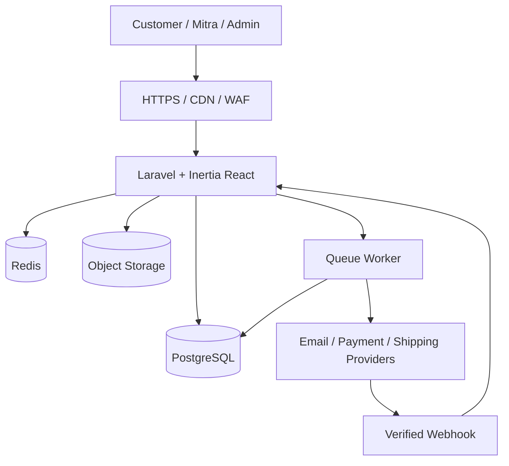

# PRD — HoneyCommerce: Toko Online Madu, Mitra & Komisi Penjualan

**Versi:** 1.0 (draft penawaran)  
**Tanggal:** 26 Oktober 2026  
**Status:** Untuk discovery, estimasi, dan persetujuan klien  
**Brand:** Nama sementara; diganti sesuai merek klien.

## 1. Ringkasan eksekutif

HoneyCommerce adalah platform toko online responsif untuk penjualan madu, herbal, dan produk terkait, dilengkapi pendaftaran mitra, tautan referral, struktur sponsor, komisi berdasarkan transaksi produk yang valid, serta pencairan komisi terkontrol. Tahap awal difokuskan pada toko online dan komisi langsung; fitur jaringan bertingkat dirilis setelah skema kompensasi dan aspek legal disepakati.

**Positioning penawaran:** _Toko online + sistem mitra dan komisi otomatis_, bukan sekadar website katalog.

## 2. Tujuan dan metrik keberhasilan

- Customer dapat mencari produk, checkout, membayar, dan memantau pesanan.
- Admin dapat mengelola produk, stok, pesanan, pengiriman, mitra, dan komisi.
- Mitra dapat membagikan tautan referral dan melihat komisi transparan.
- Tidak ada komisi ganda untuk satu transaksi; refund membatalkan atau mengoreksi komisi.
- Metrik: conversion rate, jumlah order paid/delivered, GMV, omzet bersih, mitra aktif, penjualan per mitra, total komisi earned/paid, refund rate, dan margin kontribusi.

## 3. Asumsi & pertanyaan discovery sebelum kontrak

1. Jumlah SKU, varian ukuran madu, batch/expired, gudang, dan stok awal?
2. Apakah hanya reseller/afiliasi atau benar-benar skema MLM bertingkat? Berapa level dan siapa yang berhak menerima komisi?
3. Apakah komisi dihitung dari harga produk sebelum diskon, setelah diskon, atau margin? Apakah ongkir/pajak dikecualikan?
4. Apakah pelanggan boleh checkout tanpa akun? Apakah mitra wajib disetujui admin?
5. Metode pembayaran (transfer manual vs payment gateway), kurir, dan area layanan?
6. Kapan komisi dianggap earned (misalnya setelah order delivered + masa retur)? Minimum payout dan jadwal pencairan?
7. Apakah sudah memiliki domain, hosting, materi foto, logo, kebijakan retur, serta legalitas produk/usaha?
8. Siapa PIC konten, operasional, dan persetujuan UAT?

## 4. Batasan kepatuhan bisnis

- Desain kompensasi harus berbasis **penjualan produk nyata kepada konsumen**, bukan pembayaran perekrutan atau kewajiban membeli paket untuk memperoleh bonus.
- Jangan menjanjikan penghasilan pasti atau membuat mekanisme piramida.
- Jika model merupakan penjualan langsung berjenjang/MLM, lakukan review aturan Indonesia yang berlaku, perizinan melalui OSS, ketentuan perdagangan/penjualan langsung, perlindungan konsumen, dan dokumen skema kompensasi oleh penasihat hukum sebelum aktivasi produksi.
- Klaim kesehatan madu/herbal dan izin edar/label produk harus ditinjau sesuai kategori dan ketentuan BPOM/PIRT/halal yang relevan; hindari klaim penyembuhan tanpa dasar.
- Atur kebijakan privasi, persetujuan pemasaran, keamanan data pribadi, pajak, dan pencatatan komisi/payout. Rancangan teknis ini bukan pendapat hukum.

## 5. Pengguna dan peran

| Role        | Akses utama                                                                 |
| ----------- | --------------------------------------------------------------------------- |
| Super Admin | Pengaturan sistem, role, aturan komisi, audit, semua laporan                |
| Admin Toko  | Produk, stok, order, shipment, customer                                     |
| Finance     | Verifikasi pembayaran, ledger, komisi, payout, refund                       |
| Mitra       | Link/kode referral, order atribusi, jaringan yang diizinkan, saldo & payout |
| Customer    | Katalog, checkout, akun, pesanan, retur                                     |

Semua akses menggunakan server-side authorization (policy/permission), bukan sekadar menyembunyikan menu.

## 6. Scope per fase

### Fase 1 — MVP wajib

- Landing page, katalog, kategori, pencarian, halaman produk dan varian.
- Keranjang, checkout, alamat, ongkir manual/flat (integrasi kurir opsional), pesanan.
- Pembayaran transfer manual + unggah bukti; integrasi gateway sebagai opsi.
- Admin produk, varian, stok, order, pelanggan, laporan dasar.
- Registrasi/login mitra, kode referral unik, atribusi pembelian, komisi direct (1 level).
- Dompet komisi: pending/available/paid, request payout dan persetujuan manual.
- Audit log, notifikasi email dasar, dashboard admin/mitra, ekspor CSV.

### Fase 2 — Jaringan & otomasi

- Struktur sponsor unilevel, komisi hingga N level **setelah persetujuan legal dan finansial**.
- Aturan komisi per produk/kategori/periode, plafon komisi, simulasi sebelum publish.
- Integrasi payment gateway dengan webhook tervalidasi, kurir, tracking, notifikasi WhatsApp via provider resmi.
- Refund/return lebih lengkap, batch & kedaluwarsa, laporan keuangan/komisi lanjutan.

### Fase 3 — Scale

- Multi-gudang, loyalty, voucher, rank mitra berbasis penjualan, rekonsiliasi payout otomatis, analitik cohort, PWA.

**Out of scope MVP:** aplikasi Android native, komisi binary/matrix, payout bank otomatis, marketplace sync, multi-tenant SaaS, AI recommendation, live shopping.

## 7. User journeys

### Pembelian biasa

Customer → katalog → cart → checkout → pilih pembayaran → order `pending_payment` → konfirmasi pembayaran → `paid` → diproses → dikirim → `delivered` → selesai.

### Pembelian referral

Mitra membagikan `https://domain.tld/r/KODE` → sistem menyimpan atribusi sesuai aturan cookie/session dan pilihan checkout → customer checkout → snapshot sponsor dan aturan komisi disimpan pada order → pembayaran valid → komisi `pending` → order memenuhi masa retur → komisi `available` → payout disetujui → `paid_out`.

### Refund

Refund sebagian/penuh → transaksi penyesuaian ledger (bukan menghapus histori) → komisi pending dibatalkan atau saldo available dikoreksi → jika sudah dibayar, dibuat receivable/offset payout berikutnya dengan review finance.

## 8. Aturan komisi dan anti-fraud

- Basis default: `net_merchandise_amount = subtotal_produk - diskon_produk`, tidak termasuk ongkir dan pajak yang dipungut; finalisasi bersama finance.
- Contoh ilustratif: harga net Rp150.000; komisi direct 10% = Rp15.000. Jika disetujui model 3 level: L1 10%, L2 3%, L3 2% = total Rp22.500. **Angka ini contoh, bukan rekomendasi margin final.**
- Syarat: transaksi benar-benar dibayar, tidak fraud, tidak dibatalkan; komisi baru tersedia setelah status dan masa retur terpenuhi.
- Referral self-purchase, duplikasi akun, referral hijacking, perubahan sponsor retroaktif, dan pembayaran palsu harus dicegah/ditinjau.
- Atribusi default disarankan first-valid-referral dengan TTL 30 hari; bisa diubah saat discovery. Sponsor immutable setelah approval, perubahan harus diaudit.
- Komisi tidak boleh melebihi plafon bisnis yang disetujui. Jika total komisi melebihi budget, sistem menolak publish aturan.
- Aturan baru **tidak berlaku surut**. Simpan `commission_rule_version`, basis perhitungan, dan snapshot jalur penerima di order.
- Semua payout idempotent; komisi dihitung sekali per order item/beneficiary/rule version.

## 9. Persyaratan fungsional (prioritas)

| ID    | Fitur              | Prioritas | Acceptance criteria                                   |
| ----- | ------------------ | --------- | ----------------------------------------------------- |
| FR-01 | Katalog & varian   | P0        | Harga/stok akurat; produk nonaktif tak dapat dibeli   |
| FR-02 | Checkout           | P0        | Validasi stok, total, alamat; order bernomor unik     |
| FR-03 | Pembayaran         | P0        | Admin memverifikasi manual; tidak dapat paid dua kali |
| FR-04 | Admin order        | P0        | Transisi status tervalidasi dan diaudit               |
| FR-05 | Registrasi mitra   | P0        | Referral unik; approval opsional                      |
| FR-06 | Komisi direct      | P0        | Hanya order eligible; tanpa double posting            |
| FR-07 | Wallet/ledger      | P0        | Saldo = agregasi ledger, bukan angka edit manual      |
| FR-08 | Payout             | P0        | Request, review, paid/rejected; bukti tercatat        |
| FR-09 | Laporan            | P0        | Filter tanggal, ekspor CSV, role-scoped               |
| FR-10 | Multi-level        | P1        | Maksimum level, snapshot sponsor, batas komisi        |
| FR-11 | Gateway & webhook  | P1        | Signature valid, replay safe, reconciliation          |
| FR-12 | Pengiriman & retur | P1        | Tracking, refund partial, reversal ledger             |
| FR-13 | Batch & expired    | P1        | FEFO opsional; stok batch terlacak                    |
| FR-14 | Notifikasi WA      | P1        | Consent & template resmi, retry aman                  |

## 10. Tech stack Laravel (direkomendasikan)

| Layer         | Teknologi                                                                                            | Alasan                                                |
| ------------- | ---------------------------------------------------------------------------------------------------- | ----------------------------------------------------- |
| Backend       | **Laravel 12/13** (pilih versi stabil dan didukung saat implementasi), PHP 8.3+ sesuai compatibility | Ekosistem matang, queue, policy, migrations           |
| Frontend      | **React + TypeScript + Inertia.js + Tailwind CSS**                                                   | UI modern tanpa memisahkan backend/API terlalu dini   |
| UI            | shadcn/ui atau komponen React setara, Lucide                                                         | Dashboard konsisten dan cepat                         |
| Database      | **PostgreSQL 16+**                                                                                   | Transaksi ACID, constraints, recursive query jaringan |
| Cache/Queue   | Redis + Laravel Queue/Horizon (jika kompatibel)                                                      | Komisi/notifikasi asynchronous                        |
| Auth          | Laravel starter kit/Inertia auth, Sanctum bila perlu API eksternal                                   | Session aman, token opsional                          |
| Permission    | Spatie Laravel Permission + Laravel Policies                                                         | RBAC granular                                         |
| Files         | S3-compatible object storage                                                                         | Foto produk & bukti pembayaran                        |
| Payments      | Transfer manual MVP; Midtrans/Xendit sebagai opsi                                                    | Disesuaikan kebutuhan merchant                        |
| Shipping      | Tarif manual MVP; API aggregator kurir sebagai opsi                                                  | Kurangi risiko integrasi awal                         |
| Testing       | Pest/PHPUnit, Laravel feature tests, Playwright E2E                                                  | Verifikasi uang, order, komisi                        |
| Infra         | Ubuntu LTS, Nginx, PHP-FPM, PostgreSQL, Redis, SSL                                                   | Deployment sederhana                                  |
| Observability | Sentry (opsional), log terstruktur, backup & alert                                                   | Operasional produksi                                  |

**Arsitektur awal:** modular monolith Laravel + Inertia. Pisahkan domain `Catalog`, `Checkout`, `Orders`, `Inventory`, `Partners`, `Referrals`, `Commissions`, `Wallet`, `Payouts`, `Reports`, `Admin`. Jangan gunakan microservices untuk MVP.

## 11. Topologi



## 12. Model data relasional

### Tabel inti

- `users`: id, name, email, phone, password_hash, status, timestamps.
- `roles`, `permissions`, pivot Spatie.
- `customers`: id, user_id nullable, profile fields.
- `addresses`: id, customer_id, recipient, phone, region, address, postal_code.
- `categories`: id, parent_id, name, slug, status.
- `products`: id, category_id, sku, name, slug, description, status, weight_g.
- `product_variants`: id, product_id, sku, attributes_json, price, cost, status.
- `product_images`: id, product_id, storage_key, sort_order.
- `inventory_movements`: id, variant_id, quantity_delta, reason, reference_type/id, idempotency_key.
- `carts`, `cart_items`.
- `orders`: id, order_number, customer_id, partner_referral_id nullable, subtotal, discount_total, shipping_total, tax_total, grand_total, currency, status, placed_at.
- `order_items`: id, order_id, variant_id, qty, unit_price_snapshot, discount_snapshot, cost_snapshot.
- `payments`: id, order_id, provider, provider_reference, amount, status, verified_at.
- `shipments`: id, order_id, courier, tracking_number, status.
- `partners`: id, user_id, referral_code UNIQUE, sponsor_partner_id nullable, approved_at, status.
- `referral_attributions`: id, partner_id, customer_id nullable, token_hash, source, expires_at.
- `commission_rules`: id, version, level, product_id nullable, category_id nullable, rate_percent, fixed_amount, valid_from, valid_until, status, cap_amount.
- `commission_entries`: id, order_item_id, beneficiary_partner_id, level, rule_id, base_amount, amount, status, eligible_at, unique_key UNIQUE.
- `wallet_ledger_entries`: id, partner_id, commission_entry_id nullable, payout_id nullable, entry_type, amount_signed, currency, idempotency_key UNIQUE, created_at.
- `payout_requests`: id, partner_id, amount, status, bank_account_token/reference, requested_at, approved_by, paid_at.
- `refunds`: id, order_id, amount, reason, status, processed_at.
- `audit_logs`: actor_id, action, subject_type/id, before_json, after_json, ip_hash, created_at.
- `webhook_events`: provider, event_id UNIQUE, signature_verified, payload_hash, processed_at.

**Catatan:** simpan uang sebagai integer minor unit (rupiah utuh bila IDR tanpa pecahan), bukan float; FK, indeks, unique constraints, dan check constraints. Data rekening sensitif dienkripsi dan aksesnya dibatasi.

### Relasi utama

`User 1–1 Partner`; `Partner 1–N Partner` (sponsor); `Order 1–N OrderItem`; `OrderItem 1–N CommissionEntry`; `Partner 1–N CommissionEntry`; `Partner 1–N WalletLedgerEntry`; `Partner 1–N PayoutRequest`.

## 13. API / route kontrak awal

Gunakan Inertia web routes untuk UI. Endpoint JSON internal atau `/api/v1` disiapkan untuk integrasi ke depan.

| Method | Endpoint                                 | Fungsi                           |
| ------ | ---------------------------------------- | -------------------------------- |
| GET    | `/api/v1/products`                       | List/filter katalog              |
| GET    | `/api/v1/products/{slug}`                | Detail produk                    |
| POST   | `/api/v1/checkout/quote`                 | Validasi harga/stok/ongkir       |
| POST   | `/api/v1/orders`                         | Buat order idempotent            |
| GET    | `/api/v1/orders/{id}`                    | Detail order terotorisasi        |
| POST   | `/api/v1/partners/apply`                 | Ajukan mitra                     |
| GET    | `/api/v1/partner/dashboard`              | Statistik mitra                  |
| GET    | `/api/v1/partner/referrals`              | Referral & jaringan terotorisasi |
| GET    | `/api/v1/partner/commissions`            | Komisi & status                  |
| POST   | `/api/v1/partner/payouts`                | Request payout                   |
| GET    | `/api/v1/admin/orders`                   | Kelola order                     |
| POST   | `/api/v1/admin/commission-rules/preview` | Simulasi aturan                  |
| POST   | `/api/v1/admin/commission-rules/publish` | Publish aturan tervalidasi       |
| POST   | `/api/v1/admin/payouts/{id}/approve`     | Approval finance                 |
| POST   | `/api/v1/webhooks/payments/{provider}`   | Webhook signature-verified       |

Semua write endpoint memerlukan auth/CSRF atau signature yang sesuai, validation, authorization, rate limiting, dan idempotency key untuk operasi finansial.

## 14. Mesin komisi: rancangan algoritma

1. Saat checkout, validasi referral dan simpan `partner_referral_id` beserta snapshot sponsor/rule version.
2. Setelah payment terverifikasi, emit `OrderPaid` via outbox/after-commit.
3. Worker mengunci order terkait dan menghitung basis net per item; traversing sponsor sampai batas level yang disetujui.
4. Untuk tiap penerima, buat `commission_entries` dengan unique key `order_item:beneficiary:level:rule_version`.
5. Posting ledger pending; setelah delivered + masa retur, pindahkan melalui entri ledger terpisah ke available.
6. Payout: reserve saldo secara transaksional, review finance, catat paid/rejected, release reserve bila gagal.
7. Refund/chargeback: buat reversal yang dapat ditelusuri; jangan hapus baris ledger.

**Wajib diuji:** double webhook, concurrent payout, refund parsial, diskon, split item, perubahan sponsor, aturan kedaluwarsa, user suspended, payout gagal, transaksi retry.

## 15. UI / sitemap

### Public

- `/` beranda & promo
- `/products` katalog
- `/products/{slug}` detail produk
- `/cart`, `/checkout`, `/order/{number}`
- `/about`, `/contact`, `/faq`, `/privacy`, `/terms`, `/returns`
- `/r/{code}` redirect referral tervalidasi

### Mitra

- `/partner/dashboard`, `/partner/referrals`, `/partner/network`, `/partner/commissions`, `/partner/payouts`, `/partner/profile`

### Admin

- `/admin/dashboard`, `/admin/products`, `/admin/inventory`, `/admin/orders`, `/admin/customers`, `/admin/partners`, `/admin/commission-rules`, `/admin/payouts`, `/admin/reports`, `/admin/settings`, `/admin/audit`

**Desain:** warna madu amber/emas, krem, putih, hijau herbal sebagai aksen; mobile-first; CTA “Belanja Sekarang” dan “Gabung Mitra”; foto produk autentik; label harga jelas; aksesibilitas WCAG dasar.

## 16. Non-functional requirements

- HTTPS, secure cookie, CSRF, XSS/SQL injection mitigation, 2FA untuk admin/finance bila memungkinkan.
- Password hashing bawaan Laravel; secrets di environment/secret manager; least privilege.
- P95 halaman utama target < 3 detik pada koneksi wajar; gunakan cache & optimasi gambar.
- Backup DB otomatis harian, retensi dan restore drill; target RPO/RTO disepakati sebelum produksi.
- Logging tanpa membocorkan data pembayaran/PII; audit semua perubahan komisi, payout, dan role.
- Rate limiting login/referral/webhook; CAPTCHA bila ada abuse; anti-bot.
- Pagination, indexing, transaction boundaries, deadlock retry, monitoring queue.
- Target kompatibilitas: Chrome, Edge, Safari mobile versi modern.

## 17. Testing dan kriteria penerimaan UAT

- Customer dapat menyelesaikan satu order dari katalog sampai selesai.
- Harga total konsisten di cart, checkout, invoice, dan database.
- Stok tidak menjadi negatif saat dua customer checkout bersamaan.
- Komisi direct untuk order eligible sesuai rule, tanpa double count.
- Pembatalan/refund membalikkan komisi secara benar.
- Mitra A tidak dapat membaca saldo/data pribadi mitra B.
- Payout tidak dapat melebihi available balance.
- Admin dapat mengubah aturan komisi untuk transaksi mendatang dan melihat audit trail.
- Laporan order dan ledger dapat direkonsiliasi.
- Backup dipulihkan sukses di staging.

## 18. Tahapan implementasi dan estimasi

Estimasi untuk satu developer fullstack, materi konten dan keputusan klien tersedia tepat waktu. Belum termasuk audit legal/integrasi pihak ketiga yang rumit.

| Tahap           | Deliverable                                    | Estimasi       |
| --------------- | ---------------------------------------------- | -------------- |
| 0. Discovery    | Skema komisi, flow, wireframe, scope final     | 3–5 hari kerja |
| 1. Fondasi      | Laravel, auth, role, UI kit, database, CI      | 4–6 hari       |
| 2. Commerce     | Katalog, cart, checkout, order, stok, admin    | 8–12 hari      |
| 3. Mitra        | Referral, dashboard, direct commission, wallet | 7–10 hari      |
| 4. Finance      | Payout manual, reversal, laporan, audit        | 5–8 hari       |
| 5. QA & go-live | E2E, UAT, hardening, deployment, training      | 5–7 hari       |

**Total MVP:** sekitar **32–48 hari kerja** (6–10 minggu kalender tergantung revisi dan integrasi). Multi-level/gateway/kurir diestimasi terpisah.

## 19. Paket penawaran untuk closing (harga indikatif, bukan harga pasar terverifikasi)

| Paket                | Cakupan                                                                              | Harga usulan           |
| -------------------- | ------------------------------------------------------------------------------------ | ---------------------- |
| Starter              | Toko online, admin produk/order, transfer manual, tanpa komisi                       | **Rp5.500.000**        |
| Growth — rekomendasi | Starter + mitra, referral 1 level, komisi otomatis, saldo, payout manual, laporan    | **Rp9.500.000**        |
| Network              | Growth + komisi unilevel sampai 3 level, rule versioning, simulasi, laporan jaringan | **Mulai Rp15.000.000** |

**Syarat harga:** scope final setelah discovery; belum termasuk domain, hosting, biaya gateway/SMS/WhatsApp, pajak, legal review, data entry massal, foto produk, dan pengembangan fitur tambahan. Multi-level hanya diaktifkan setelah skema bisnis/legal disetujui.

**Termin usulan:** DP 40% saat mulai, 30% setelah demo staging fitur inti, 30% setelah UAT dan sebelum go-live. Garansi bug 30 hari untuk fitur dalam scope; maintenance dan perubahan fitur terpisah.

**Biaya operasional perkiraan untuk diskusi:** hosting VPS dan backup mulai sekitar Rp200.000–Rp600.000/bulan tergantung traffic/arsitektur; angka final mengikuti penyedia dan kebutuhan. Domain, provider pesan, gateway, dan biaya transaksi terpisah.

## 20. Script penawaran singkat

> Kami menawarkan website toko online untuk madu dan produk herbal yang tidak hanya menerima pesanan, tetapi juga membantu mengembangkan penjualan lewat mitra. Setiap mitra punya link referral sendiri; penjualan dan komisinya tercatat otomatis, sehingga pemilik toko bisa mengatur bonus tanpa menghitung manual. Untuk tahap awal, kami sarankan paket Growth agar toko segera bisa berjualan dan menguji sistem komisi satu level. Jika jaringan sudah berkembang dan skema bisnisnya disetujui, sistem bisa ditambah komisi bertingkat tanpa membangun ulang.

## 21. Risiko dan mitigasi

| Risiko                      | Mitigasi                                                   |
| --------------------------- | ---------------------------------------------------------- |
| Skema MLM belum jelas/legal | Discovery & legal sign-off sebelum implementasi bertingkat |
| Margin habis oleh komisi    | Simulator biaya, batas persentase dan budget               |
| Komisi dobel                | Unique constraints, ledger, idempotency, test concurrency  |
| Refund setelah payout       | Reserve/offset, finance review, kebijakan tertulis         |
| Scope creep                 | Change request dan estimasi tambahan tertulis              |
| Klien belum siap konten     | Template data produk, checklist foto dan copywriting       |
| Hosting/operasional         | Backup, monitoring, SOP admin, maintenance                 |

## 22. Checklist serah terima

- [ ] Scope dan skema komisi ditandatangani
- [ ] Hak akses admin dan mitra diuji
- [ ] Katalog dan konten disetujui
- [ ] Checkout/pembayaran/pengiriman diuji
- [ ] Komisi, reversal, payout, dan laporan direkonsiliasi
- [ ] Kebijakan privasi/retur dan legal produk ditinjau
- [ ] UAT sign-off
- [ ] Domain, SSL, backup, monitoring aktif
- [ ] Akun dan dokumentasi admin diserahkan
- [ ] Masa garansi bug dan SLA maintenance tertulis

## 23. Master prompt Codex — implementasi bertahap

```text
Anda adalah senior software architect dan fullstack Laravel engineer.
Bangun proyek HoneyCommerce sesuai PRD ini menggunakan Laravel versi stabil yang kompatibel, React + TypeScript + Inertia.js + Tailwind, PostgreSQL, Redis, dan Spatie Permission.

Aturan:
1. Mulai dengan audit workspace. Jangan menimpa proyek atau konfigurasi yang sudah ada tanpa izin.
2. Buat modular monolith dengan domain Catalog, Orders, Inventory, Partners, Commissions, Wallet, Payouts, Reports.
3. Terapkan Laravel Policies, validation, migrations, FK, unique constraints, transactional writes, audit logs, dan test.
4. Uang sebagai integer IDR, tidak menggunakan floating point. Semua operasi komisi/payout idempotent.
5. MVP hanya komisi direct 1 level. Buat abstraction rule version agar multi-level bisa ditambahkan, tetapi jangan aktifkan bonus bertingkat tanpa sign-off.
6. Jangan membuat komisi hanya dari pendaftaran/rekrutmen. Komisi hanya dari transaksi produk eligible.
7. Gunakan payment manual pada MVP; siapkan adapter gateway untuk fase berikutnya.
8. Kerjakan bertahap: Phase 0 architecture/database/ADRs; Phase 1 auth+roles; Phase 2 catalog+cart+checkout; Phase 3 referral+direct commission; Phase 4 wallet+payout; Phase 5 QA+deploy.
9. Di akhir setiap fase: daftar file berubah, command migrasi/test, hasil test, risiko, dan langkah berikutnya.
10. Jangan deploy ke produksi, mengirim uang, atau mengubah data produksi tanpa persetujuan eksplisit.

Mulai dari Phase 0: susun ERD, migrations, domain services, state machine order/payment/commission/payout, acceptance tests, dan struktur folder. Setelah selesai, berhenti dan tunggu persetujuan untuk Phase 1.
```

---

**Catatan:** Seluruh harga, durasi, tingkat komisi, dan aturan atribusi adalah asumsi penawaran awal yang perlu disepakati dengan klien.
