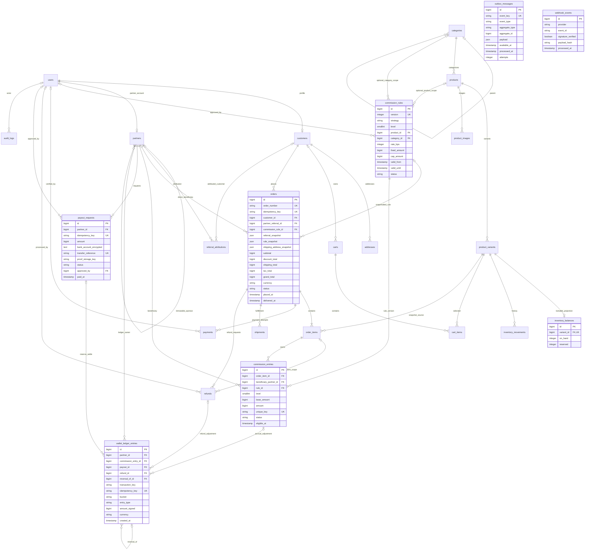
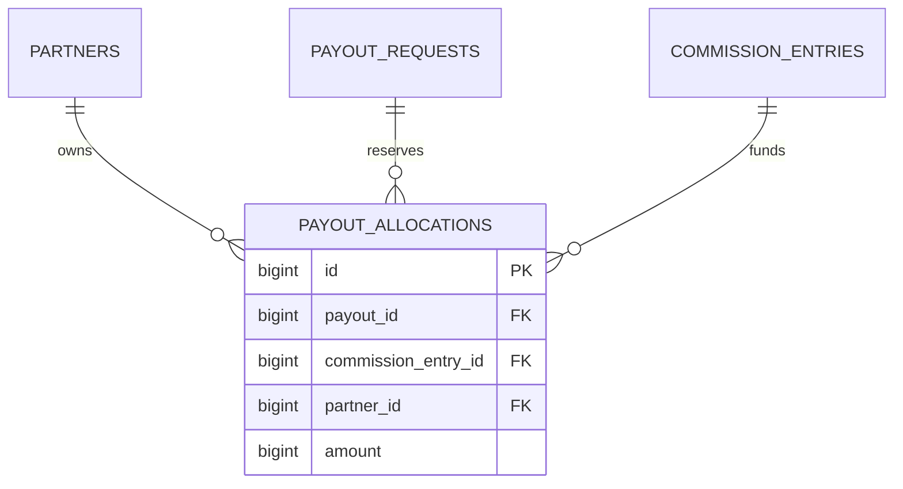

# ERD - HoneyCommerce Phase 0

Schema sumber: empat migration `*honey_commerce*` pada `database/migrations`. Semua tabel memakai bigint primary key. Auth users/tables sudah ada dan tidak dibuat ulang. Migrations Spatie disiapkan oleh vendor pada Phase 1, belum termasuk 24 tabel domain ini.

Cardinality diagram menunjukkan kontrak bisnis; minimal satu order_item ditegakkan checkout action, bukan FK saja. Audit/outbox/inventory polymorphic references memakai subject/aggregate/reference type + id dan tidak bisa diberi FK ke satu tabel; source entity disimpan immutable/restrict sesuai domain dan divalidasi action.

## Constraint penting

- Unique: product/variant sku, category/product slug, referral code, user partner/customer, token_hash, cart+variant, order number/idempotency, rule version, commission entitlement tuple, ledger/payout/refund/payment idempotency, provider+event_id, provider+payment reference.
- Semua parent historis memakai FK restrict-on-delete. Produk yang pernah dibeli dinonaktifkan, bukan dihapus.
- MySQL generated verified_order_id dengan unique index: hanya satu payment verified/refunded per order. Multiple pending/rejected attempts diperbolehkan.
- FK komposit ledger memastikan partner_id cocok dengan beneficiary komisi/pemilik payout, bukan sekadar parent ID ada.
- CHECK: level selalu 1, direct_v1, rule version positif, rate 0-10000 bps, nominal positif/nonnegatif sesuai domain, total order konsisten, stock reserved <= on_hand, status dari allowlist, currency IDR, metadata approval/proof ketika paid.
- Trigger: wallet ledger dan audit append-only; rule published immutable (status boleh retired); sponsor immutable sesudah approved_at.
- Clock timestamp; batas rule/report menggunakan interval `[from, until)`. Data sensitif JSON bukan tempat menyimpan rekening plaintext.
- Redis tidak menyimpan saldo utama. `inventory_balances` hanya projection yang diperbarui bersama movement dalam satu transaksi.

## Batas enforcement Phase 0

Konsistensi jumlah order_items vs subtotal, nominal payment vs order, refund kumulatif, eligibility paid/delivered, sponsor cycle antarbaris, ledger double-entry dan minimum payout tetap memerlukan action domain transaksional. Belum ada endpoint domain yang menulisnya. CHECK schema bukan pengganti Policies/validation/business actions. Workflow dan acceptance gate fase terkait dirinci pada [acceptance.md](acceptance.md).

## Penambahan Phase 2 - MySQL

- product_variants.discount_amount BIGINT: diskon rupiah per unit, 0 sampai price.
- orders.request_fingerprint CHAR/VARCHAR(64), cart_id FK nullable, expires_at nullable dan index status+expires_at.
- payments.proof_hash untuk fingerprint bukti; verified_order_id generated nullable dan unique, terisi order_id hanya untuk verified/refunded.
- JSON di MySQL/MariaDB dan timestamp dikelola dalam timezone aplikasi; jangan mengandalkan tipe PostgreSQL JSONB/timestamptz.
- Self sponsor/parent dicegah lewat trigger; audit/ledger append-only, rule/sponsor immutable dan owner composite FK dipasang migration MySQL.
- Model/factory domain commerce hadir pada app/Domains dan database/factories. Tidak ada migrasi data ke PostgreSQL.

## Penambahan workflow finance MVP

payout_allocations UNIQUE(payout_id, commission_entry_id); CHECK amount > 0; composite owner FK (payout_id, partner_id) dan (commission_entry_id, partner_id). orders menambah fraud_hold, commission_checked_at dan return_window_days. order_items menyimpan commission_rule_id dan commission_snapshot. commission_entries menyimpan reversed_amount/offset_amount; payout_requests menyimpan request_fingerprint dan bank_last4; refunds menyimpan request_fingerprint. Rekening payout tetap encrypted:array, tidak disalin ke ledger/audit/CSV.
