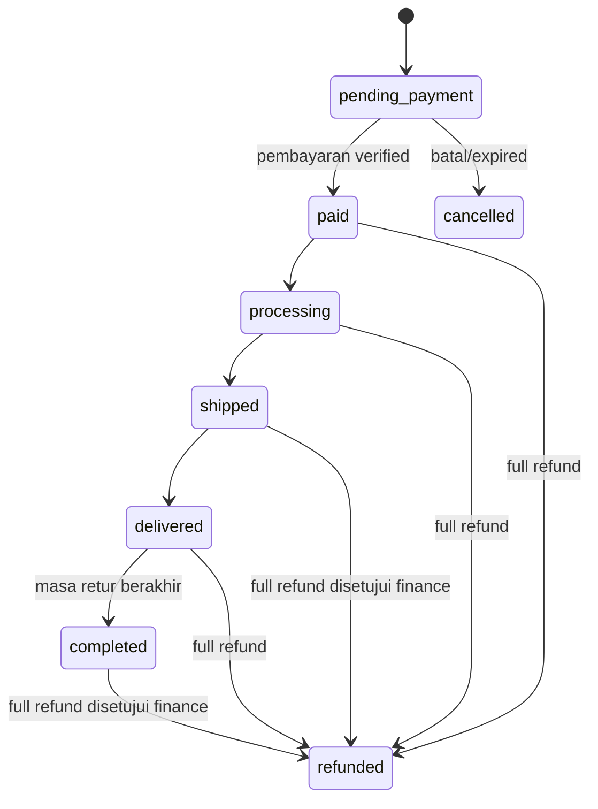
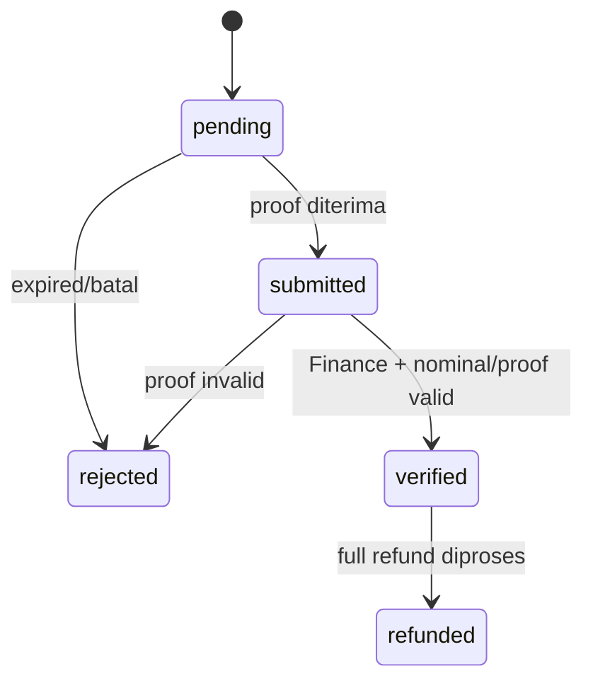
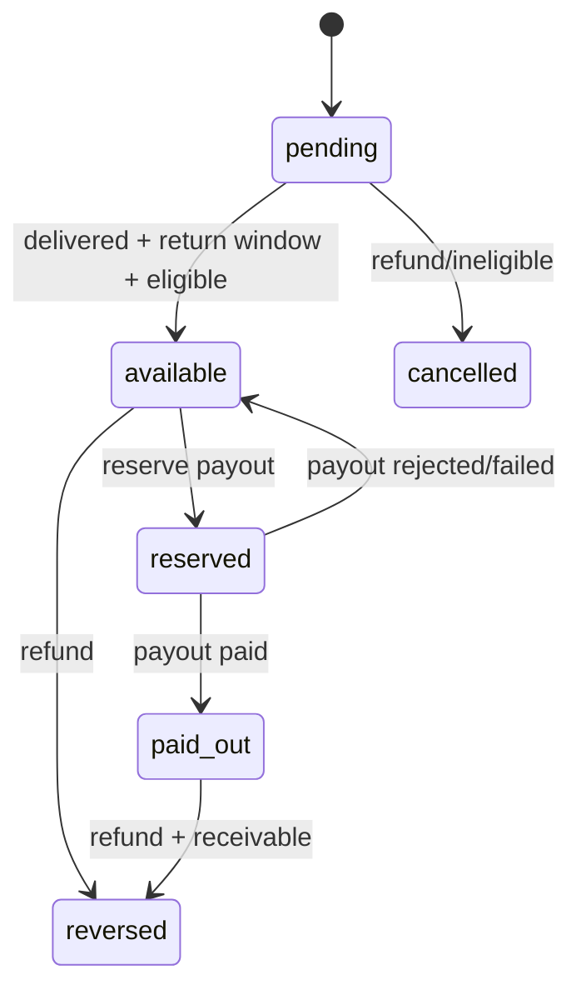
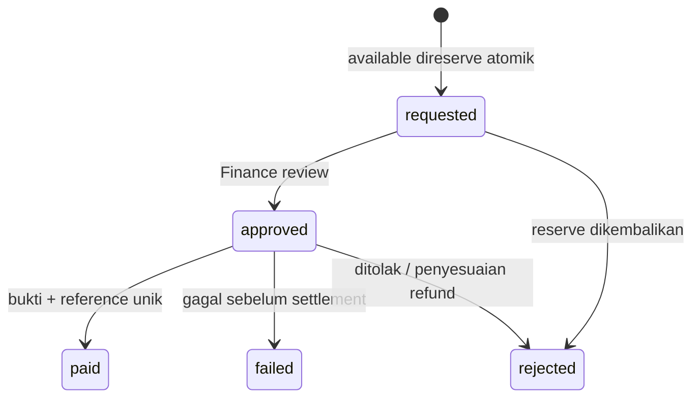

# State machines dan business guards

Enum graph dan domain actions MVP Phase 2?4 telah diimplementasikan. Repeated request tidak membuat self-transition: idempotency replay dikembalikan sebelum validasi graph.

Order: status `paid` hanya sesudah jumlah pembayaran verified sama grand_total. Shipping memerlukan payment valid dan reservasi stok. Delivery harus memiliki shipment evidence. Cancel pending melepaskan stok; paid order memakai refund flow, bukan cancellation tanpa reversal. Partial refund mencatat refund row dan ledger delta, status fulfillment dipertahankan. Cancelled/refunded terminal.

Payment: tidak ada transisi pending langsung verified. Provider manual tidak pernah menyatakan paid otomatis. Rejected terminal untuk attempt itu; attempt baru boleh dibuat. Satu order hanya punya satu verified/refunded payment attempt. Webhook adapter fase mendatang memerlukan signature, dedupe provider+event_id, matching nominal/currency/order dan replay protection.

Commission: dibuat hanya dari order item produk eligible yang telah dibayar; beneficiary bukan pembeli dan partner aktif; rule published/effective pada placed_at dan snapshot direct disimpan. Tidak ada sumber commission dari registrasi, sponsor assignment atau recruitment. Unique (order_item, beneficiary, level, rule) + unique_key mencegah duplicate entitlement. Cancellation pending membalik pending ledger. Full reversal sudah paid tidak menghilangkan saldo historis paid; buat receivable. Refund saat reserved harus membatalkan/membekukan payout dulu melalui finance workflow, bukan melompati state graph. Partial refund mengurangi entitlement melalui adjustment ledger, status tetap jika masih ada sisa.

Payout: minimum dan partner aktif diperiksa pada request. Lock partner row lalu sum ledger; amount <= available setelah offset receivable. Approved memerlukan approved_by/approved_at, paid memerlukan paid_at/proof/reference. Rejected/failed melepaskan reserve sekali. Retry pembayaran yang hasilnya tidak pasti harus direkonsiliasi sebelum membuat request baru; jangan mengirim ulang hanya karena timeout. Penarikan sebagian saldo tersedia melalui alokasi FIFO per komisi. Payout bank otomatis tidak termasuk MVP. Status komisi bersifat ringkasan; sisa nominal, reversed_amount, offset_amount dan payout_allocations menjadi dasar hak tarik.

## Transaction contract

Action domain membuka transaksi, melakukan Gate::authorize/policy serta guard, mengunci aggregate, menulis domain effects/ledger serta audit dalam transaksi yang sama. Operasi order/payment memakai TransitionRecorder; komisi, payout dan refund memakai guard/transisi eksplisit pada action domain dan menulis audit/outbox secara atomik. Recorder mengunci kembali aggregate secara reentrant pada koneksi yang sama, menulis audit teredaksi dan outbox. Semua error menyebabkan rollback. Audit idempotency key harus global per operasi, misalnya `order:{id}:cancel:{request-uuid}`.

Model domain menyimpan nilai status sesuai enum dan guard action; request membatasi operasi yang boleh dipilih. Nominal tervalidasi sebagai integer IDR. Tidak ada endpoint bonus rekrutmen atau komisi bertingkat.
